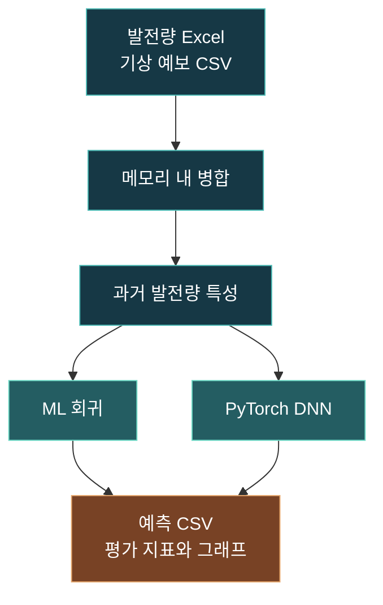

<p align="center"><strong>한국어</strong> &nbsp;|&nbsp; <a href="README.en.md">English</a></p>

<picture>
  <source media="(prefers-reduced-motion: reduce)" srcset="assets/readme-banner.webp">
  
</picture>

<h1 align="center">풍력 발전량 예측</h1>
<p align="center"><strong>기상 예보와 과거 발전량을 활용한 제주 풍력 사례 연구</strong></p>
<p align="center">
  
  
  <a href="wind_power_predictor/configs/experiment.yaml"></a>
</p>
<p align="center">
  <a href="#프로젝트-구조">프로젝트 구조</a> &nbsp;|&nbsp;
  <a href="#실행-방법">실행 방법</a> &nbsp;|&nbsp;
  <a href="#원본-논문">원본 논문</a>
</p>

## 공개 이력

- v2.0.0 공개 (패키지 및 YAML 설정 통합, PyTorch 전환, 메모리 내 데이터 병합)
- v1.0.0 공개

## 개요

- **예측 조건** 4시간 선행 기상 예보와 3시간 단위 과거 발전량 사용
- **연구 대상** 제주 한경 1구역, 한경 2구역, 성산 풍력발전소



## 프로젝트 구조

| 경로 | 역할 |
| --- | --- |
| [`wind_power_predictor/configs/experiment.yaml`](wind_power_predictor/configs/experiment.yaml) | 데이터, 특성, 모델 및 출력 설정 |
| [`wind_power_predictor/models/`](wind_power_predictor/models) | ML 회귀 모델과 PyTorch DNN 예측 모델 |
| [`wind_power_predictor/datasets/`](wind_power_predictor/datasets) | 발전량과 기상 원천 데이터 읽기 |
| [`wind_power_predictor/preprocessing/`](wind_power_predictor/preprocessing) | 발전량 집계, 기상 예보 선택, 시각 기준 병합 |
| [`wind_power_predictor/features/`](wind_power_predictor/features) | 과거 발전량 특성 생성, 학습·평가 분할, 스케일링 |
| [`wind_power_predictor/reporting/`](wind_power_predictor/reporting) | 예측 결과 저장, 변수 중요도, 결과 병합과 시각화 |
| [`wind_power_predictor/experiment.py`](wind_power_predictor/experiment.py) | 발전소 및 과거 발전량 입력 개수별 학습 흐름 |
| [`wind_power_predictor/scripts/`](wind_power_predictor/scripts) | ML과 DNN 학습 명령 |
| [`wind_power_predictor/tests/`](wind_power_predictor/tests) | 패키지에 포함된 회귀 테스트 |
| [`examples/`](examples) | 패키지 외부에 보존한 연구용 원본 스크립트 |

## 실행 방법

### 설치

저장소 루트에서 편집 가능 모드로 패키지 설치

```sh
python -m pip install -e .
```

Windows CPU에서 DNN 학습 시 PyTorch 별도 설치 (검증 버전 `2.15.0+cpu`)

```sh
python -m pip install torch --index-url https://download.pytorch.org/whl/cpu
```

#### 필수 라이브러리

패키지 설치 시 함께 설치되는 주요 라이브러리. [전체 설치 목록](requirements.txt)

| 라이브러리 | 버전 조건 | 용도 |
| --- | --- | --- |
| NumPy | `==1.26.4` | 배열 연산 |
| pandas | `==2.2.1` | 데이터 읽기, 전처리 및 병합 |
| openpyxl | `>=3.1,<4` | 발전량 엑셀 파일 읽기 |
| PyYAML | `>=6,<7` | 실험 설정 읽기 |
| scikit-learn | `==1.4.1.post1` | 회귀 모델, 스케일링 및 평가 지표 |
| LightGBM | `==4.3.0` | LightGBM 회귀 모델 |
| XGBoost | `>=2,<4` | XGBoost 회귀 모델과 변수 중요도 |
| Matplotlib | `>=3.8,<4` | 예측 그래프 저장 |
| Plotly | `>=5,<8` | 대화형 예측 결과 시각화 |

### 입력 데이터

한경 1구역 원천 파일 경로 예시 (일부)

```text
dataset/rawdata/
├── wind/
│   └── 붙임1_한경풍력 발전실적 정보.xlsx
└── weather/
    └── hankyeong/
        └── 2014/
            └── weather_forecast_temp3h.csv
```

엑셀 경로와 시트 번호, 예보 지역 및 연도 관리 [실험 설정](wind_power_predictor/configs/experiment.yaml)

### 실행 명령

```sh
python -m wind_power_predictor.scripts.train_ml ./dataset/rawdata hk1 --history 0
python -m wind_power_predictor.scripts.train_dnn ./dataset/rawdata hk1 --history 0
```

학습 실행 전 데이터와 모델 조건 변경 [실험 설정](wind_power_predictor/configs/experiment.yaml)

| 옵션 | 역할 |
| --- | --- |
| `--history` | 과거 발전량 입력 개수 (생략 시 설정값 전체, 기본 h0~h5) |
| `--output` | 출력 경로 재지정 (기본 `predictionresult/`) |
| `--feature-importance` | `train_ml`의 XGBoost 변수 중요도 실험 |

### 회귀 테스트

```sh
python -m unittest discover -s wind_power_predictor/tests -v
```

## 원본 논문

Min-Woo Baek, Min Kyu Sim, Jae-Yoon Jung (2020년 9월). *Wind Power Generation Prediction Based on Weather Forecast Data Using Deep Neural Networks*. [논문 PDF](http://www.icicelb.org/ellb/contents/2020/9/elb-11-09-07.pdf)
